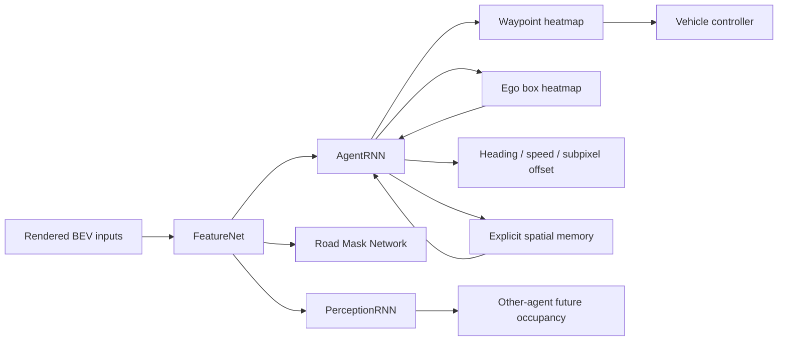

# ChauffeurNet 深度导读

> **论文**：ChauffeurNet: Learning to Drive by Imitating the Best and Synthesizing the Worst  
> **作者**：Mayank Bansal, Alex Krizhevsky, Abhijit Ogale  
> **会议**：Robotics: Science and Systems (RSS), 2019  
> **原文**：[本地 PDF](../../../papers/A_core/01_ChauffeurNet_2019.pdf) · [官方 PDF](https://www.roboticsproceedings.org/rss15/p31.pdf)  
> **对照版本**：[2-3 页精炼导读](../01_ChauffeurNet_导读.md)  
> **本文定位**：约 5-8 页的深度导读，突出 planning representation、闭环鲁棒性和工程迁移  
> **建议用时**：先读本文 45-60 分钟，再用 60-90 分钟精读原文

## 0. 一页结论

### 论文试图回答的问题

如果我们拥有大量专家驾驶数据，能否只靠 behavior cloning 学出一个足以闭环驾驶真实车辆的 planner？

ChauffeurNet 给出的答案是：**仅增加正常专家数据不够。** 即使输入已经由感知系统转成结构化 BEV，输出也已经简化为轨迹而不是低层控制，数千万样本的纯模仿仍会在闭环中卡住、越界或碰撞。原因不是单纯容量不足，而是专家数据几乎不包含“已经偏离正确状态后应该怎么恢复”的监督。

### 核心方案

论文做了三件彼此依赖的事：

1. 使用结构化鸟瞰输入和连续轨迹输出，把 perception 与 vehicle control 暂时移出学习问题；
2. 在专家轨迹附近合成位置、方向和几何扰动，让训练分布覆盖闭环可能访问的坏状态；
3. 增加 collision、on-road、geometry 等环境损失，并通过 imitation dropout 防止专家模仿项压制这些损失。

这三件事不能拆开理解。只有扰动而没有环境损失，模型可能继续模仿扰动后的坏轨迹；只有环境损失而没有坏状态，安全项在模型接近专家时几乎没有梯度。ChauffeurNet 的真正贡献是把 **state coverage** 与 **cost shaping** 组合起来。

### 它在自动驾驶栈中的位置

ChauffeurNet 不是 raw-sensor-to-control，也不是今天所说的 unified perception-prediction-planning：

```text
camera / lidar / map
        ↓  外部感知、跟踪和地图系统
结构化 top-down raster
        ↓
ChauffeurNet learned planner
        ↓
future pose + heading + speed
        ↓  外部 vehicle controller / optimizer
steering + acceleration + brake
```

最准确的分类是：**mid-level input 下的 learned trajectory planner replacement，控制层仍是传统模块。**

### 为什么今天仍值得精读

它在 2019 年已经清楚提出四个今天仍成立的判断：

- open-loop waypoint error 不能代表闭环驾驶质量；
- 历史轨迹可能产生 shortcut，而不是真正的场景因果理解；
- planner 输出连续轨迹比直接控制更方便施加车辆约束和跨车型复用；
- 稀有失败状态需要主动构造，不能等待自然日志覆盖。

## 1. 问题背景：为什么 3000 万样本仍然不够

行为克隆从专家状态-动作对中学习：

$$
\pi_\theta = \arg\min_\pi\; \mathbb{E}_{(s,a)\sim D_{expert}}[\ell(\pi(s), a)].
$$

训练时，状态 $s$ 来自专家访问分布 $d_{expert}$；部署后，哪怕模型只有很小误差，下一时刻的状态也由模型自己的动作决定，状态分布逐渐变成 $d_{\pi}$。一旦 $d_{\pi}$ 偏离 $d_{expert}$，模型就在缺少训练样本的区域继续预测，误差会递归累积。

ChauffeurNet 的典型失败是窄路上的路边停车车辆。专家日志大多记录顺利通过的轨迹，却很少包含：车辆已经靠得太近、航向已经偏斜、需要先避让再回到车道中心的恢复状态。纯模仿可以学到“专家通常在哪里”，却未必学到“偏离后如何回去”。

论文没有采用在线 DAgger 或完整 RL，主要原因是：真实车辆上主动执行不安全动作以收集专家纠正不可接受；而对复杂交通参与者进行高保真仿真本身就很困难。作者选择了受控的离线邻域扩展：在专家轨迹附近合成坏状态，但仍使用真实日志场景和专家终点结构。

## 2. 表示选择：先把 perception 与 control 难度拿掉

### 2.1 Ego-centric top-down 坐标系

车辆在时刻 $t$ 的状态表示为：

$$
(p_t, \theta_t, s_t), \qquad p_t=(x_t,y_t),
$$

其中 $p_t$ 是位置，$\theta_t$ 是航向，$s_t$ 是速度。当前 ego pose 固定在栅格中的 $(u_0,v_0)$，鸟瞰图随车移动。栅格尺寸为 $W\times H$，分辨率为 $\phi$ 米/像素，前向可见范围为：

$$
R_{fwd}=(H-v_0)\phi.
$$

实验采用 $W=H=400$、$u_0=200$、$v_0=320$、$\phi=0.2$ m/pixel，因此覆盖 80 m × 80 m，前向约 64 m。训练时坐标方向在 ego heading 周围随机旋转 $\Delta=\pm25^\circ$，减少网络对“竖直向上驾驶”的位置偏置。

### 2.2 七类输入

Figure 2 将输入拆成七组 raster：

| 输入 | 包含的信息 | 对规划的作用 |
|---|---|---|
| Roadmap | 车道、停止线、人行横道、路缘等 | 可行空间和规则结构 |
| Speed limit | 沿车道中心编码的限速 | 速度先验 |
| Traffic lights | 过去多个时刻的信号灯状态 | 交通控制和时序状态 |
| Route | 类似导航系统提供的目标路线 | 消除路口意图歧义 |
| Current agent box | 当前 ego 几何占据 | 规划起点与车身尺寸 |
| Dynamic boxes | 车辆、行人、骑行者的历史框序列 | 动态交互上下文 |
| Past agent poses | ego 历史位置轨迹 | 运动趋势与历史状态 |

场景历史以固定间隔 $\delta t=0.2$ s 采样。动态场景历史 $T_{scene}=1$ s，ego 历史 $T_{pose}=8$ s，未来预测步数 $N=10$，即输出约 2 s 的轨迹。

### 2.3 输出为什么选 trajectory

模型递归预测未来 pose：

$$
p_{t+\delta t}=\mathrm{ChauffeurNet}(I,p_t),
$$

最终得到：

$$
\{p_{\delta t},p_{2\delta t},\ldots,p_{N\delta t}\},
$$

并同时预测 heading 与 speed。轨迹再交给控制优化器转成 steering 与 braking。

这个接口有三点规划价值：

1. 轨迹与车辆型号解耦，不同车辆可以用不同 controller 跟踪同一几何意图；
2. 可以在控制层加入动力学、转向角、加速度等硬约束；
3. 比“距离前车、红绿灯状态”等固定 affordance 列表更通用，能表达路口和绕障几何。

它的代价是强依赖上游感知与地图，而且不是完整传感器到动作的端到端优化。

## 3. 架构：FeatureNet + AgentRNN + 辅助场景任务

### 3.1 总体数据流



FeatureNet 是带 skip connections 和大感受野的卷积网络，生成共享场景特征 $F$。三个任务头共享它：

- AgentRNN：生成 ego 轨迹，是部署时的规划核心；
- PerceptionRNN：递归预测其他交通参与者未来 occupancy；
- Road Mask Network：预测可行驶区域。

后两个任务主要用于训练共享表示，并不是一个显式 prediction result 再被 planner 调用的模块化链路。因此它更像 multi-task feature shaping，而不是 UniAD 式 task-query 级联。

### 3.2 AgentRNN 的递归状态

第 $k$ 个未来步的核心关系是：

$$
p_k,B_k=\mathrm{AgentRNN}(k,F,M_{k-1},B_{k-1}),
$$

其中：

- $p_k$：预测的下一 waypoint；
- $B_k$：该时刻 ego box 的概率热力图；
- $M_{k-1}$：此前预测位置累积形成的单通道 spatial memory；
- $B_{k-1}$：上一时刻预测的车辆占据；
- $k$：未来时间步索引。

网络首先对二维空间输出 waypoint probability heatmap，通过 argmax 得到粗像素位置，再由浅层 meta-prediction network 回归 subpixel offset、heading 和 speed。这里的显式 memory 不是 LSTM 隐状态，而是把已经预测过的位置在图像上累加，直接告诉网络“轨迹走到哪里了”。

### 3.3 为什么同时预测 ego box

只预测点 $p_k$ 无法直接表达车身占据范围。$B_k(x,y)$ 让 collision、on-road 和 geometry loss 可以在 raster 空间中对整个车辆 footprint 计算重叠，从而把环境约束传回轨迹网络。

这是一项很现代的设计：规划输出不仅要有中心线，还要保留可用于约束计算的 occupancy support。今天可用 differentiable footprint、signed distance field 或 trajectory corridor 实现同类目标。

## 4. 从模仿损失到环境损失

### 4.1 基础模仿损失

AgentRNN 每一步输出 waypoint 分布 $P_k(x,y)$、ego box heatmap $B_k(x,y)$ 和 heading $\theta_k$。基础损失为：

$$
L_p=\mathcal{H}(P_k,P_k^{gt}),
$$

$$
L_B=\frac{1}{WH}\sum_x\sum_y \mathcal{H}(B_k(x,y),B_k^{gt}(x,y)),
$$

$$
L_\theta=\lVert\theta_k-\theta_k^{gt}\rVert_1.
$$

其中 $P_k^{gt}$ 是只在 ground-truth waypoint 像素处为 1 的 one-hot spatial target。粗网格预测后，meta head 再预测 subpixel offset $\delta p_k$ 和 speed $s_k$：

$$
L_{p\text{-subpixel}}=\lVert\delta p_k-\delta p_k^{gt}\rVert_1,
$$

$$
L_{speed}=\lVert s_k-s_k^{gt}\rVert_1.
$$

这些损失共同定义：

$$
L_{imit}=\{L_p,L_B,L_\theta,L_{p\text{-subpixel}},L_{speed}\}.
$$

注意这里并不是简单的 waypoint coordinate L2。位置通过分类热力图学习，亚像素精度单独回归，车辆几何和朝向也被监督。

### 4.2 Past motion dropout：消除专家历史捷径

训练数据里的 past ego trajectory 来自专家，可能泄漏未来行为。例如，车辆在停车标志前的历史已经开始减速，模型只需外推减速趋势，不必识别停车标志。部署后历史来自模型自身；如果模型之前没有减速，它就永远得不到“该停车”的历史提示。

论文对 50% 的训练样本抹掉 past poses，只保留当前 $(u_0,v_0)$。它迫使 FeatureNet 使用交通灯、道路、障碍物等外部因果线索。

从现代角度看，这属于 shortcut intervention。它的启发不限于历史轨迹：teacher action、未来地图标签、route curvature、控制器状态都可能成为训练时存在、部署时分布不同的泄漏通道。

## 5. Synthesizing the Worst：扰动怎样产生有效安全梯度

### 5.1 轨迹扰动过程

作者保持轨迹起点和终点不变，对中间 pose 施加扰动：

- 横纵位置分别在 $[-0.5,0.5]$ m 中均匀采样；
- heading 在 $[-\pi/3,\pi/3]$ 中扰动；
- 用原起点、扰动中点、原终点拟合平滑轨迹；
- 用最大曲率阈值过滤明显不可执行的轨迹。

关键是：碰撞或越界的扰动样本不会全部被过滤。它们就是 collision/on-road loss 所需要的负例。perturbed examples 在训练中的权重为正常样本的 1/10，避免模型把异常驾驶当作常态。

### 5.2 Collision loss

令 $Obj_k^{gt}(x,y)$ 表示时刻 $k$ 其他物体的占据 mask，则：

$$
L_{collision}=\frac{1}{WH}\sum_x\sum_y B_k(x,y)Obj_k^{gt}(x,y).
$$

它惩罚 ego occupancy 与其他物体的重叠。纯专家日志几乎没有碰撞，所以如果模型已经贴近专家，collision loss 往往接近零。扰动样本把 ego 放进潜在冲突区域，才使该项持续产生梯度。

### 5.3 On-road loss

令 $Road^{gt}(x,y)$ 为可行驶区域：

$$
L_{onroad}=\frac{1}{WH}\sum_x\sum_y B_k(x,y)(1-Road^{gt}(x,y)).
$$

它把车身越过路缘、驶上中央隔离带等行为直接写进训练目标。与 waypoint L1 不同，它并不要求复现专家的唯一轨迹，只要求不要占据不可行驶区域。

### 5.4 Geometry loss

作者对目标 waypoints 拟合平滑几何曲线，并按车宽渲染成 $Geom^{gt}$：

$$
L_{geom}=\frac{1}{WH}\sum_x\sum_y B_k(x,y)(1-Geom^{gt}(x,y)).
$$

这一项约束几何形状，而不要求复制具体速度 profile。它可以理解为软 trajectory corridor，但仍来自专家轨迹附近，不是真正独立的可行域优化。

### 5.5 辅助预测损失

PerceptionRNN 预测其他 agent 的未来 occupancy：

$$
L_{objects}=\frac{1}{WH}\sum_x\sum_y \mathcal{H}(Obj_k(x,y),Obj_k^{gt}(x,y)).
$$

Road Mask Network 预测道路区域：

$$
L_{road}=\frac{1}{WH}\sum_x\sum_y \mathcal{H}(Road(x,y),Road^{gt}(x,y)).
$$

它们的主要作用是迫使共享特征包含道路结构和其他交通参与者动态。需要注意，论文没有证明这些预测在推理时形成了显式可解释的 planner cost；它们首先是 representation regularization。

### 5.6 Imitation dropout

环境损失集合为：

$$
L_{env}=\{L_{collision},L_{onroad},L_{geom},L_{objects},L_{road}\}.
$$

总损失为：

$$
L=w_{imit}\sum_{\ell\in L_{imit}}\ell+w_{env}\sum_{\ell\in L_{env}}\ell.
$$

最终模型在部分样本上随机令 $w_{imit}=0$，而不是始终把 imitation loss 乘一个较小常数。原因是，专家模仿梯度可能持续把模型拉回专家中心线，使环境项只成为微弱正则；随机完全关闭 imitation 后，某些 batch 只能依据安全与几何约束更新。

这不是简单的 loss reweighting。它产生两类优化状态：一类学习“像专家”，另一类学习“即使不复制专家，也不要做坏事”。

## 6. 实验设计：消融究竟验证了什么

### 6.1 数据与运行成本

训练数据来自真实专家驾驶，约 2600 万样本，相当于约 60 天连续驾驶。作者去除了长时间静止和高速公路片段。动态对象与交通灯来自独立的 camera/lidar perception system；地图与限速为先验信息。

在 NVIDIA P100 上，总延迟约 160 ms：

| 部分 | 时间 |
|---|---:|
| 输入渲染 | 8 ms |
| FeatureNet | 6.5 ms |
| AgentRNN，10 步 | 145 ms |
| PerceptionRNN，10 步 | 35 ms |
| Overall | 160 ms |

表中各模块可能存在并行/共享，因此各项不能简单相加。最明显的瓶颈是逐步自回归 AgentRNN。

### 6.2 五个模型配置

| 模型 | 组成 | 用途 |
|---|---|---|
| M0 | imitation + past dropout | 纯模仿基线 |
| M1 | M0 + trajectory perturbation | 测试扰动本身 |
| M2 | M1 + environment losses | 测试扰动与安全损失组合 |
| M3 | M2 + imitation 权重降到 0.5 | 连续 reweighting 基线 |
| M4 | M2 + imitation dropout，概率 0.5 | 最终模型 |

这个消融顺序很好，因为它明确区分 data augmentation、constraint loss 与优化权重机制。

### 6.3 闭环仿真协议

系统先重放日志，直到积累足够历史输入；随后模型输出轨迹，controller 在 vehicle simulator 中推进 ego pose。下一帧输入根据新的 ego pose 重新渲染，因此 ego 会看到自己的误差结果，这构成闭环。

但其他动态对象和交通灯继续来自日志。它能测试 ego drift 和局部恢复，却不是充分 reactive multi-agent simulation。这个边界在解读“closed-loop”时必须写清。

### 6.4 三类关键场景

#### 绕过路边停车车辆

在 4 个地点和 5 种初速度下构造 20 个场景。M0 只有 20% 通过，50% 碰撞，30% 卡住；M4 达到 90% 通过、10% 碰撞。M1-M3 多数仍有约 45%-60% 碰撞。

这说明扰动或环境损失单独存在都不够；imitation dropout 使安全约束真正影响了策略。但 M4 的 10% 碰撞部分来自极高相对速度、物理上可能来不及避让，因此不能把这个数字直接当模型绝对安全率。

#### 从位置/航向偏差恢复

在弯道入口改变横向偏差、航向误差和速度，共 20 个场景。M0 全部卡住；M1/M2 在较低速度的一半场景恢复；M3/M4 达到 100% 恢复。

这是对 covariate shift 最直接的验证：纯专家模仿不会自动获得 recovery behavior。

#### 跟随慢车

M3 在该组场景达到 100% 正确减速；M4 约 85% 正确减速，另有碰撞或卡住。M4 在最高相对速度时会尝试激进绕行并擦到道路边缘。

这个反例很重要：让环境损失更强并不必然更安全，它可能把“避免追尾”转化成另一种未经充分约束的绕行行为。局部 cost shaping 不能替代交互式策略数据。

### 6.5 因果输入消融

作者分别在 20 个场景中显示/隐藏停车标志，以及显示/隐藏其他车辆；M4 在这些对照中表现出正确行为。其意图是验证模型确实响应停车标志或车辆，而不是只复现历史速度趋势。

这个实验规模很小，但方法论值得保留：现代 VLA 也应做 language/vision intervention，而不只是观察 attention map 或 rationale。

### 6.6 Open-loop 与 closed-loop 的反向结论

在 10,000 个未扰动日志样本上，M0 的 waypoint L2 误差低于 M4；但闭环实验中 M4 显著更好。原因是 M4 为恢复和安全牺牲了对专家中心轨迹的逐点拟合。

这是全文最重要的评价结论：

$$
\text{lower imitation error} \not\Rightarrow \text{better closed-loop planner}.
$$

nuPlan、NAVSIM 等后续 benchmark 的出发点，可以直接追溯到这种差异。

### 6.7 实车证据如何解读

作者将 M4 替换原系统 planner，在测试场完成停车标志、转弯和长时间闭环驾驶，并提供视频。这证明接口可以接真实 perception 与 controller，也证明轨迹较平滑。

但论文没有报告系统化的实车里程、接管率、置信区间或与基线的统计比较。因此应写成“real-vehicle feasibility demonstration”，不能写成“大规模真实世界安全验证”。

## 7. 结果归因：哪些组件真正重要

可以把 ChauffeurNet 的效果拆成四层：

| 层次 | 作用 | 证据 |
|---|---|---|
| Mid-level representation | 降低 perception/control 样本复杂度 | 能从真实日志与仿真统一渲染输入，并接实车 controller |
| Perturbation coverage | 让模型见到偏离状态 | M0 无恢复，M1/M2 开始获得低速恢复 |
| Environment objectives | 明确处罚碰撞、越界、偏离几何 | 绕障与恢复表现改善 |
| Imitation dropout | 防止模仿梯度压制安全项 | M4 绕障远优于 M2/M3 |

不能得出的结论包括：

- 不能证明 RNN 比 Transformer 更适合 planning；
- 不能证明 raster 一定优于 vector representation；
- 不能证明 closed-loop log replay 等价于交互式交通仿真；
- 不能证明 environment loss 已经提供硬安全保证；
- 不能证明 2600 万正常样本没有价值，只能证明正常样本规模不能替代坏状态覆盖。

## 8. 局限与失败机制

### 8.1 系统边界

模型依赖地图、交通灯状态和高质量动态目标框。感知错误会直接改变 planner 输入，而论文没有端到端评估这种误差传播。它更接近 learned planning module，不是完整 E2E stack。

### 8.2 视野与分辨率

20 cm/pixel、64 m 前向范围限制高速路口、T-junction merge 和高速转弯。扩大视野会降低局部精度或显著增加栅格计算。

### 8.3 运动学可行性不是硬约束

作者观察到模型会生成不满足车辆转弯半径的几何轨迹。geometry loss 只让轨迹接近专家 corridor，并没有显式保证曲率、曲率变化率和控制可达性。

### 8.4 长尾行为覆盖不足

U-turn、cul-de-sac、低速 nudging 等仍可能失败。只在专家轨迹邻域做单次平滑扰动，无法覆盖离散 maneuver 变化和长时多阶段决策。

### 8.5 交互性有限

高度交互的 merge、博弈式让行或稀有场景仍会失败。扰动改变 ego pose，但没有让其他 agent 对 ego 新行为作真实反应。作者也将该系统定位为更好 simulator/RL 的起点，而不是终点。

### 8.6 优化目标可能诱导替代性坏行为

collision loss 可以推动模型避开慢车，却不保证绕行本身合法或可行。M4 的激进绕行就是典型 cost misspecification：禁止 A 后，策略选择了未充分处罚的 B。

## 9. 站在 2026 年回看：哪些过时，哪些仍是主线

| 论文设计 | 今天的判断 |
|---|---|
| 手工渲染 BEV raster | 架构较旧，但结构化场景接口仍常见；可替换为 BEV feature、vector query 或 occupancy token |
| AgentRNN 自回归 waypoint | 已被 Transformer、diffusion、flow 等替代，但 sequential trajectory decoding 仍有效 |
| 显式 spatial memory | 简单但可解释；今天可用 trajectory query/history token |
| Perturb expert trajectory | 仍是闭环鲁棒训练的核心手段之一 |
| Collision/on-road soft loss | 仍常用，但通常需要与 hard projection、search 或 safety layer 组合 |
| Imitation dropout | 具体技巧较少直接沿用，但“平衡 imitation 与 objective optimization”已演化为 RL/RFT/post-training |
| Open-loop vs closed-loop 反差 | 完全没有过时，仍是 E2E planner 评价的核心矛盾 |

从演进角度看，后续工作主要在三个方向扩展 ChauffeurNet：

1. 输入从结构化真值/感知 raster 走向 raw RGB/LiDAR，如 TransFuser；
2. 训练从离线扰动走向 privileged teacher、DAgger、RL 或 closed-loop post-training，如 LBC、PlannerRFT；
3. 单模态轨迹回归走向 discrete behavior、diffusion/flow distribution 和 meta-action。

## 10. 对泊车 E2E planner 的直接启发

### 10.1 为什么泊车比论文场景更需要结构化 action

ChauffeurNet 的道路驾驶轨迹通常保持同一前进方向，2 s waypoint 足以表达局部行为。多把泊车包含明确的离散边界：前进、停车、换挡、倒车、再次调整。若把整段过程当作连续 waypoint 回归，换挡附近容易出现速度符号模糊、轨迹平均化和终止状态不稳定。

因此可将 ChauffeurNet 的 pose perturbation 升级为 maneuver-level perturbation：

- 对初始位置、航向、目标车位 pose 做扰动；
- 对关键点和换挡点做扰动；
- 构造错误 gear、过早/过晚换挡、停在局部死点等状态；
- 让教师或规则系统提供 corrective maneuver，而不只是回到原 waypoint。

### 10.2 推荐的层级接口

```text
surround-view / BEV / slot goal
              ↓
maneuver state: gear + intent + subgoal + termination
              ↓
key point / diffusion trajectory segment
              ↓
kinematic projection + controller
              ↓
closed-loop recovery and next maneuver
```

这里，SunnyParking 的 motion state、YUKUIv2 的 key point + diffusion、DriveMA 的 verifiable meta-action，都可以看作把 ChauffeurNet 的连续恢复思想推进到结构化多阶段 action space。

### 10.3 可迁移的损失

| ChauffeurNet | 泊车版本 |
|---|---|
| collision loss | ego footprint 与静态/动态障碍的时空占据重叠 |
| on-road loss | 可行驶区域、车位边界、墙/路缘约束 |
| geometry loss | 与 maneuver corridor 或 Hybrid A* teacher corridor 的偏差 |
| past motion dropout | 随机遮蔽历史控制/轨迹，防止只根据上一挡位外推 |
| imitation dropout | 部分 batch 只优化安全、终点、运动学和换挡一致性 |
| pose perturbation | 初始 pose、slot pose、key point、gear boundary 联合扰动 |

但 soft loss 不够。泊车必须增加：最大转角、曲率、曲率变化、速度符号与 gear 一致性、换挡时零速条件，以及最终 pose tolerance 等硬约束或投影。

## 11. 与下一批论文的继承关系

### ChauffeurNet → Learning by Cheating

两者都承认纯 offline BC 不够。ChauffeurNet 在日志附近合成纠错状态；LBC 则训练 privileged teacher，并让 student on-policy rollout 后向教师查询标签。前者是离线状态扩展，后者更接近 DAgger。

### ChauffeurNet → nuPlan

ChauffeurNet 用 M0 与 M4 证明 open-loop L2 排名会误导闭环质量；nuPlan 把这一问题制度化为 planning benchmark，进一步区分 open-loop、non-reactive 与 reactive closed-loop。

### ChauffeurNet → TransFuser

两者都输出 waypoint 并由 PID/控制器执行。ChauffeurNet 刻意使用 mid-level raster，TransFuser 则学习 RGB/LiDAR multi-scale fusion，把 perception burden 重新放进 policy。

### ChauffeurNet → TCP

ChauffeurNet 主张 trajectory 比 direct control 更通用；TCP 则指出两者各有失败模式，用 trajectory branch 指导 control branch，再融合最终动作。TCP 可以视为对“规划输出还是控制输出”这一接口选择的进一步回答。

## 12. 如果要复现，建议怎么做

不建议按 2019 架构逐层复刻。更有研究价值的是复现它的因果命题。

### 最小实验

固定一个现有 BEV waypoint planner 和 controller，训练五个版本：

1. BC baseline；
2. + pose/heading perturbation；
3. + collision/on-road/kinematic loss；
4. + continuous imitation reweighting；
5. + stochastic imitation dropout 或 constraint-only batch。

### 必须报告的指标

- open-loop ADE/FDE 或 waypoint error；
- closed-loop success、collision、off-road、goal progress；
- recovery rate，按初始横向/航向误差切片；
- 卡死率和最小障碍距离；
- 运动学不可行率；
- 推理延迟与 trajectory horizon；
- 至少 3 个 training seeds，而不只是 simulator 重复 rollout。

### 泊车扩展消融

在上述五个版本上再比较：

- 纯连续轨迹 vs gear + trajectory；
- 单段轨迹 vs maneuver segments；
- 原始 waypoint regression vs key-point + diffusion；
- 只扰动 pose vs 同时扰动 gear boundary/key point；
- soft constraints vs kinematic projection。

最有价值的验证不是平均轨迹误差，而是：当车辆已经处于专家数据很少覆盖的错误 pose 或错误 maneuver state 时，模型能否重新规划并完成入位。

## 13. 原文精读路线

建议不要从头线性阅读，按以下顺序：

1. **Figure 1 + Introduction**：先抓住 3000 万样本仍失败的核心矛盾。
2. **Figure 2**：逐项确认输入中哪些来自地图、感知、历史和导航。
3. **Figure 3-4 + Eq. (1)-(2)**：弄清 FeatureNet、AgentRNN、spatial memory 与三类输出。
4. **Section IV + Eq. (3)-(7)**：理解基础模仿目标和 past motion shortcut。
5. **Figure 5 + Eq. (8)-(13)**：看扰动、环境损失和 imitation dropout 如何配合。
6. **Table III + Figure 6**：逐个模型配置解释三类闭环结果。
7. **Figure 7**：重点理解 open-loop 指标为何与闭环结论相反。
8. **Failure Modes + Discussion**：把失败归因到视野、运动学、数据覆盖与交互性。

## 14. 读完后应该能够回答的 12 个问题

1. 为什么纯 behavior cloning 的主要问题不是“专家数据太少”这么简单？
2. ChauffeurNet 为何不属于 raw-sensor end-to-end driving？
3. 为什么论文选择 trajectory 而不是 steering/throttle 作为学习输出？
4. AgentRNN 的 spatial memory 与普通 RNN hidden state 有什么区别？
5. 为什么 past ego motion 会变成训练 shortcut？
6. 为什么 collision loss 在正常专家样本上容易没有有效梯度？
7. trajectory perturbation 与 DAgger、DART 的联系和区别是什么？
8. imitation dropout 为什么不同于把 imitation loss 权重从 1 降到 0.5？
9. Figure 6 中 M4 的激进行为说明了什么 cost specification 问题？
10. 为什么 M0 的 open-loop L2 更低，却是更差的闭环 driver？
11. 论文的 closed-loop simulator 是否包含其他 agent 对 ego 的真实反应？
12. 把方法迁移到 multi-shot parking 时，哪些变量必须从连续轨迹中显式拆出来？

## 15. 最终评价

ChauffeurNet 不是现代架构意义上最先进的 E2E 模型，却仍是 planning 学习路线中的奠基论文。它最有价值的不是 RNN、raster 或某个损失公式，而是建立了一个完整论证：

```text
专家日志只覆盖“做对时的状态”
    → 纯模仿在闭环中离开训练分布
    → 合成错误状态扩大 coverage
    → 环境目标告诉模型哪些恢复更安全
    → 闭环评价验证恢复，而不是只奖励贴近日志
```

对正在从传统泊车规划转向 AI/E2E/VLA 的工程师，最值得带走的原则是：**动作表示可以学习，安全约束可以软化，感知接口可以端到端化，但恢复状态的覆盖和闭环评价不能省略。**
