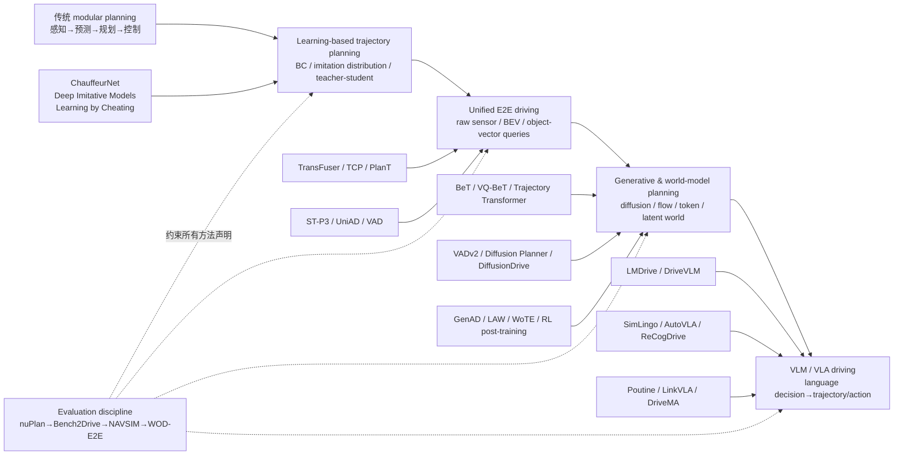
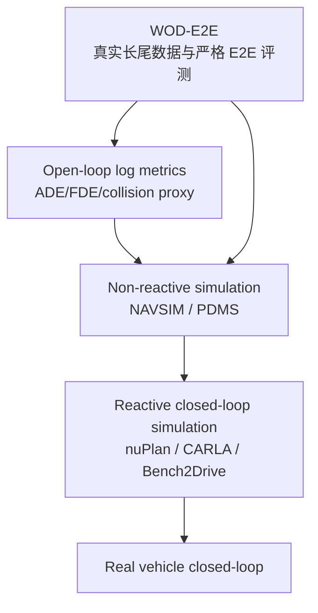
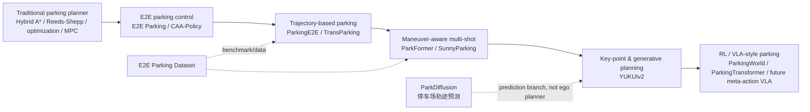

# 自动驾驶 E2E / Planning / Parking / VLA 研究脉络

这份脉络按 planner 在系统中的角色组织，而不是把所有带 “E2E”“VLM”“VLA” 的论文放进同一篮子。核心判断是：模型到底预测世界、选择行为、生成轨迹，还是直接输出控制；语言到底改变动作，还是只解释动作。

## 1. 主干脉络



这不是线性替代史。模块化接口仍然给 E2E 提供监督、可解释中间量和安全兜底；BEV/vectorized E2E 与 raw-sensor VLA 也会长期并存。真正发生的变化，是规划表示从人工设计的 cost/constraint，逐步转为 learned latent、trajectory distribution、action token 和语义化 meta-action。

## 2. 五个阶段的核心变化

| 阶段 | planner 的典型接口 | 代表工作 | 主要贡献 | 核心风险 |
|---|---|---|---|---|
| 传统 modular | objects/map/prediction → optimizer → trajectory | Hybrid A*、lattice、MPC | 可验证约束与清晰模块边界 | 误差级联、手工规则膨胀 |
| Learning-based trajectory planning | scene/goal → trajectory distribution | ChauffeurNet、Deep Imitative Models、LBC | 数据驱动行为、恢复训练、多模态概率 | covariate shift、平均化轨迹 |
| Unified E2E driving | sensors/BEV/vector queries → trajectory/control | TransFuser、ST-P3、UniAD、VAD | 联合优化并减少模块信息瓶颈 | 中间语义与安全边界变模糊 |
| Diffusion/token/world-model | structured/latent scene → sampled actions/trajectories | BeT、VADv2、Diffusion Planner、DiffusionDrive、LAW | 多模态、可引导生成、预测式决策 | 采样延迟、校准、闭环分布外失效 |
| VLM/VLA driving | vision + language + history → decision/trajectory/action | LMDrive、DriveVLM、SimLingo、AutoVLA、DriveMA | 语义泛化、人机指令、可解释动作结构 | language–action gap、虚假推理、实时性 |

### 2.1 传统规划没有消失

传统 planner 的价值是显式运动学、碰撞、规则和优化目标。学习式方法最常见的实际落地并非“一次性替换全栈”，而是：生成候选轨迹、预测 cost、提供高层行为、学习 warm start，或作为残差修正。判断论文工程价值时，应先定位它是 replacement 还是 enhancement。

### 2.2 从单轨迹回归到分布

连续 L2 回归容易在多模态行为上取平均。Deep Imitative Models 通过轨迹概率建模提供条件推断；Behavior Transformers/VQ-BeT 将行为分解成离散模式与连续残差；Diffusion/flow 方法直接学习复杂轨迹分布。它们共同回答的不是“网络更大了吗”，而是“多种合理行为如何被表示、采样和约束”。

### 2.3 Unified E2E 的两条架构路线

- Dense BEV 路线：ST-P3、UniAD。便于承载 occupancy、map、motion 等任务，但计算重、栅格分辨率与几何精度存在张力。
- Sparse/vector/object 路线：PlanT、VAD、VADv2。接口更接近规划对象与矢量地图，效率更好，但依赖查询学习和结构化场景质量。

TransFuser/TCP 则是 raw sensor feature 到轨迹/控制的另一条主线。它们并不是 UniAD/VAD 的低配版本，而是对中间表示可见性与监督方式作不同选择。

### 2.4 Generative planner 的三种用法

1. **Trajectory generator**：Diffusion Planner、GoalFlow、GuideFlow 在场景条件下直接生成候选轨迹。
2. **E2E planning decoder**：VADv2、DiffusionDrive 把生成分布嵌入 sensors-to-plan 系统。
3. **Proposal + evaluator/search**：Diffusion-ES、WoTE 用生成 prior 配合搜索或 learned world evaluation。

这三种方法不能只用同一 open-loop displacement 指标比较。第一类看可控性与可行性，第二类看系统闭环与延迟，第三类还要看 evaluator 是否在分布外可靠。

### 2.5 World model 不等于 planner

GenAD/LAW 学习可预测的潜在世界；WoTE 让世界模型评价轨迹；Think2Drive/Doe-1/RAD/Raw2Drive 用模拟世界或 latent dynamics 训练策略。只有后两类直接改变 action selection。一个 world model 能预测未来，并不自动意味着它能给出安全、因果正确的规划。

## 3. Benchmark 与证据强度



箭头表示通常更接近部署因果性，不代表右侧一定更公平或更可复现。不同 benchmark 的 traffic model、route、sensor stack 与 metric aggregation 都会影响排名。

| 证据 | 能说明 | 不能说明 |
|---|---|---|
| Open-loop imitation | 拟合数据分布、局部轨迹精度 | 闭环恢复、交互反应、长期安全 |
| NAVSIM-style non-reactive | 快速比较规划质量与规则代理指标 | ego 行为改变后其他交通参与者的反馈 |
| Reactive simulation | 闭环恢复与因果交互 | sim-to-real、真实传感器长尾 |
| Real vehicle | 特定 ODD 的部署可行性 | 大规模统计显著性，除非里程足够 |

因此，本库的 “closed_loop=yes” 只表示论文进行了某种闭环评价，不能自动等于实车，也不能自动等于交互式交通闭环。具体说明在 [papers.csv](papers/metadata/papers.csv) 的 notes 字段中。

## 4. Parking 子线



### 4.1 表示演进

| 代表工作 | 系统角色 | 输出 | single/multi-shot | 挡位/运动状态 | 关键价值 |
|---|---|---|---|---|---|
| E2E Parking | planner replacement | steering/throttle/brake/gear control | 主要是闭环停车任务 | 控制量含 gear | 最直接的视觉到控制基线 |
| ParkingE2E | trajectory generator | 连续停车轨迹 | 以轨迹规划为中心 | 交由执行系统处理 | 更容易接传统 controller，含实车验证 |
| TransParking | trajectory generator | trajectory | 主要改善端到端轨迹 | 非核心 | soft localization + dual decoder |
| ParkFormer | planner replacement | control + gear | 可处理动态停车过程 | 显式 gear selection/vehicle state | 目标、行人和控制联合建模 |
| SunnyParking | trajectory generator | multi-shot trajectory + motion state | 明确 multi-shot | 显式 motion state | 把换向边界从连续回归中抽出 |
| YUKUIv2 | structured generative planner | key point + diffusion waypoints | 明确 multi-shot | 关键点隐含 maneuver 分段 | 结构化关键点与连续生成结合 |
| ParkingWorld | RL policy | action/control | 闭环纠错 | 由 policy/环境处理 | corrective experience + 3DGS simulation |
| ParkingTransformer | VLM-enhanced trajectory planner | trajectory | 面向长距离/复杂停车过程 | 高层语义辅助 | LLM 进入决策/规划，但仍需严测因果与延迟 |

### 4.2 泊车论文的统一审查表

对任何新方法，至少检查以下八项：

1. single-shot 还是允许多次换向；
2. gear shift 是监督标签、离散状态、token，还是 controller 的隐式结果；
3. 是否满足转向角、曲率、曲率变化率、碰撞裕度等运动学约束；
4. goal/slot 是图像 crop、角点、中心位姿、BEV mask 还是自然语言；
5. 多模态是否真实保留，还是最终仍由 L2 回归塌缩；
6. closed-loop success 是否覆盖不同初始位姿、窄车位和恢复场景；
7. 动态行人/车辆是否真正 reactive；
8. 结果来自 CARLA、专用仿真、实车，还是三者之一。

### 4.3 最值得做的泊车研究接口

当前最有潜力的结构不是直接把整个停车轨迹文本化，而是层级式接口：

```text
视觉/BEV/目标车位
  → 可验证 maneuver token（前进/倒车、目标区域、终止条件、风险状态）
  → key point / subgoal
  → diffusion 或 flow 生成连续轨迹段
  → 运动学投影与 MPC/控制执行
  → 闭环反馈触发下一 maneuver
```

它把 DriveMA 式 meta-action、SunnyParking 的 motion state、YUKUIv2 的 key point 与传统可行性约束连接起来，尤其适合多把停车。

## 5. Driving VLM/VLA 的分层

| 层级 | 定义 | 代表论文 | 是否属于核心 VLA |
|---|---|---|---|
| L0：语言理解/解释 | VQA、graph reasoning、caption，不直接驱动 action | DriveLM | 否；重要数据与推理基线 |
| L1：高层决策接口 | 输出行为状态、指令或 meta decision，再交给独立 planner | DriveMLM、部分 Drive-R1 | 边界层；需验证接口是否影响轨迹 |
| L2：语言增强 trajectory | 语言/推理结果条件化或修正 trajectory planner | DriveVLM、ORION、ReCogDrive、ParkingTransformer | 是，但仍是层级系统 |
| L3：联合 language–action model | 同一模型/表示生成轨迹、控制或 action token | LMDrive、EMMA、SimLingo、AutoVLA、Poutine、NoRD、LinkVLA、DriveMA | 核心 VLA |

### 5.1 判断“真 VLA”的四个实验

1. **Language intervention**：保持视觉不变，改变指令或语义，动作是否按预期变化？
2. **Rationale ablation**：移除/打乱 reasoning，动作质量是否改变？若不变，reasoning 可能只是解释旁路。
3. **Action grounding**：语言 token/meta-action 是否能映射到明确时空轨迹与终止条件？
4. **Closed-loop latency**：完整感知、推理、解码频率能否满足控制周期？平均 latency 之外还应看尾延迟。

### 5.2 关键路线关系

- LMDrive：语言指令作为驾驶条件，证明闭环可行，但模型接口仍偏语言引导控制。
- DriveVLM：层级 chain-of-thought/decision 与传统 trajectory planner 连接，属于 planner enhancement。
- EMMA：统一多模态模型以文本化方式输出未来 waypoint 等任务，表示统一性强，但公开证据主要不是 reactive closed-loop。
- SimLingo：把语言与动作共同对齐到闭环视觉驾驶，避免只做 VQA。
- AutoVLA/ReCogDrive/Poutine：分别突出自适应推理 + RFT、认知先验 + diffusion planner、vision-language-trajectory 预训练 + RL post-training。
- NoRD：反问“每次都显式 reasoning 是否必要”，强调数据效率与直接 action generation。
- LinkVLA/DriveMA：进一步处理 language–action gap；DriveMA 用可验证 meta-action 明确语义与低层动作的桥梁。

## 6. 动作表示地图

| Action representation | 优点 | 风险 | 代表工作 | 对泊车的启发 |
|---|---|---|---|---|
| continuous trajectory | 易接 controller、几何可解释 | 多模态平均化 | ParkingE2E、VAD | 作为底层输出仍最实用 |
| direct control | 训练/部署链短 | 可迁移性与可验证性弱 | ChauffeurNet、LMDrive、E2E Parking | 可作为闭环 residual，而非唯一层 |
| discrete action token | 适合序列建模与多模态 | 量化误差、token 无语义 | BeT、VQ-BeT | 可编码短轨迹 chunk/换向模式 |
| trajectory token | 长时域统一建模 | 词表规模和误差累积 | Trajectory Transformer、部分 VLA | 适合预测 maneuver 序列 |
| meta-action | 可解释、可验证、易加规则 | 仍需低层落地 | DriveMA、DriveMLM | 最适合表达前进/倒车/对齐/终止 |
| diffusion / flow | 多模态、可条件引导 | 采样成本与校准 | Diffusion Planner、YUKUIv2 | 生成每个 maneuver 内的连续轨迹 |
| hybrid | 兼顾语义结构与连续精度 | 训练与接口复杂 | TCP、SunnyParking、DriveMA-style stack | 多把停车最推荐 |

## 7. 值得优先研究的空白

### 方向 A：可验证 maneuver token + 连续生成

假设：显式表示 `{gear, intent, subgoal, termination}`，再用 diffusion/flow 生成每段轨迹，会比整段轨迹回归更稳地处理多把与恢复。对照应包括纯轨迹回归、只加 gear 分类、key-point + regression、key-point + diffusion。

### 方向 B：泊车 language–action 因果对齐

不要先追求长 chain-of-thought。先设计可操作语言：目标车位、偏好侧、允许换向次数、避让要求、停止/继续。用干预测试验证语言变化是否只改变相关 maneuver，而不破坏运动学与安全。

### 方向 C：交互式闭环停车 benchmark

现有工作常在静态或弱交互环境中比较 success rate。一个有价值的 benchmark 应覆盖窄位、遮挡、行人横穿、动态车辆、不同初始朝向、传感噪声与 controller mismatch，并分别报告 single-shot/multi-shot 成功率、换挡数、时间、最小间距、舒适性和恢复率。

### 方向 D：生成式 planner 的实时安全层

研究低步数 diffusion/flow + 可微或非可微可行性投影：生成模型负责多模态，传统优化负责硬约束。关键不是平均 ADE，而是固定算力预算下的闭环安全/成功率曲线。

### 方向 E：world model 作为反事实 evaluator

用 world model 评估不同停车 maneuver 对动态障碍的后果，但需做 calibration 与 adversarial counterfactual audit。预测视频更逼真不等于 cost ranking 更可靠。

## 8. 结论

整个领域的主线并不是“模块化最终被大模型替代”，而是规划接口逐渐从单一连续回归，演化为可表达多模态与语义结构的分层 action representation。对你的转型而言，最值得抓住的交叉点是：**VAD/UniAD 的结构化场景接口 + BeT/DriveMA 的动作语义 + SunnyParking/YUKUIv2 的多把结构 + diffusion/flow 的连续轨迹生成 + NAVSIM/交互仿真的闭环评价纪律。**

两周精读清单与完整依赖顺序见 [reading_order.md](reading_order.md)。
